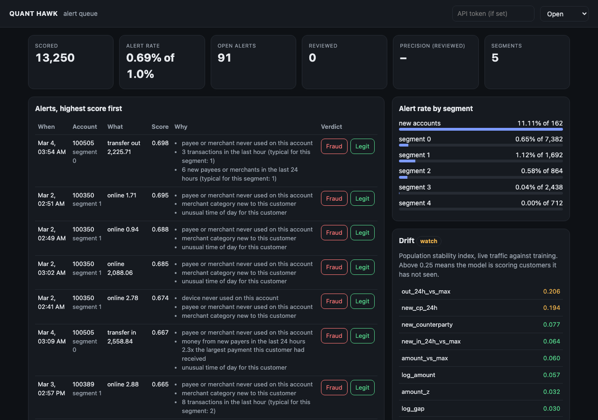
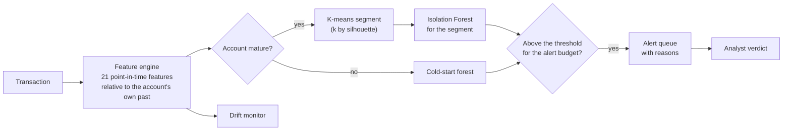

# Quant Hawk

**Unsupervised fraud detection that learns what normal looks like for each kind of
customer.** K-means groups customers by behaviour, one Isolation Forest per group learns
what is unusual *for that group*, and every alert reaches an analyst with the reasons
behind it.

A single model of "normal" learns that big and frequent are unusual. Its alert queue fills
up with small businesses paying suppliers, while a student's account being drained in
modest transfers at 3 a.m. looks unremarkable next to them. Segmenting first fixes that.



## Results

On a labelled synthetic bank (3,000 customers, 120 days, five kinds of fraud; trained on
the first 60 days, scored on the last 60, three seeds). Method, tables and limits in
[docs/benchmark.md](docs/benchmark.md).

| Model | Average precision | Fraud caught at a 1 % alert budget | Defrauded accounts caught |
|---|---:|---:|---:|
| Four bank-style rules | 0.02 | 16 % | 58 % |
| One Isolation Forest for everyone | 0.09 ± 0.02 | 44 % | 65 % |
| **Quant Hawk: K-means + one forest per segment** | **0.37 ± 0.05** | **63 %** | **82 %** |
| *Supervised gradient boosting, with labels (reference)* | *0.66 ± 0.07* | *90 %* | *98 %* |

- **Fairer alerts.** The single forest puts 4.7 % of small businesses' legitimate
  transactions in front of an analyst, and under 0.3 % of anyone else's. Quant Hawk keeps
  every kind of customer between 0.7 % and 1.1 %.
- **The segments are real.** K-means picks five on its own, and three of them are made up
  entirely of one hidden customer type. It does as well as an oracle that knows the true
  types.
- **The limit is stated, not hidden.** Fraud made of small, plausible payments spread over
  days is invisible to any anomaly detector here (at most 10 % caught); a supervised
  model with labels catches 71 % of it. The service stores analyst verdicts so those labels
  accumulate.

## How it works



- **One feature path.** The same `FeatureEngine` builds training data by replaying
  history and scores live traffic one transaction at a time, so a feature can never see
  the future in training. A test checks it.
- **Features describe the customer, not the population.** Amount against this account's
  usual on this channel, velocity, first time this device, payee, city or merchant
  category, how unusual the hour is for them, money from new payers against the largest
  they have received, the share of that money already sent on.
- **Alerts explain themselves**, in sentences an analyst can act on:

  > **Student account, transfer out 2,225.71**
  > - payee or merchant never used on this account
  > - 3 transactions in the last hour (typical for this segment: 1)
  > - 6 new payees or merchants in the last 24 hours (typical for this segment: 1)

- **Operations.** A fixed alert budget (1 % by default, set at training time), live alert
  rates per segment, analyst verdicts and their precision, and a population stability
  index per feature, so drift shows before quality drops.

Design notes: [docs/design.md](docs/design.md).

## Run it

Needs Python 3.12 and [uv](https://docs.astral.sh/uv/).

```bash
uv sync
uv run qh demo        # simulate a bank, train, serve, stream live traffic
```

Open <http://127.0.0.1:8100> for the alert queue and <http://127.0.0.1:8100/docs> for the
API. Step by step:

```bash
uv run qh simulate --out data/bank.csv.gz          # 3,000 customers, 120 days, labelled
uv run qh train --data data/bank.csv.gz            # first 60 days; writes models/ and data/
uv run qh serve                                    # warms account state from history
uv run qh replay --data data/live.csv.gz --rate 2000
```

Score a transaction:

```bash
curl -s localhost:8100/v1/transactions -H 'content-type: application/json' -d '{
  "ts": 5300000, "account_id": 100042, "channel": "transfer_out", "amount": 1800,
  "counterparty": 7777777, "device": 999, "city": 12}'
```

Set `QH_API_TOKEN` to require a bearer token on every endpoint.

Reproduce the benchmark and checks:

```bash
make evaluate    # about 8 minutes: 3 seeds, 5 models, plus the ablations
make check       # ruff, mypy --strict, pytest
```

## Repository

```
src/quanthawk/
  simulate.py   the labelled synthetic bank: six customer types, five fraud types
  features.py   point-in-time feature engine and account profiles
  model.py      K-means segmentation, per-segment forests, explanations
  artifact.py   training and the saved model (thresholds, drift reference)
  service.py    scoring API, alert queue, verdicts, stats, drift
  drift.py      population stability index
  evaluate.py   the benchmark; report.py fills docs/benchmark.md
  static/       the analyst queue
results/        raw benchmark results (JSON)
docs/           design and benchmark
```

## History

Quant Hawk was first built in 24 hours at Barclays Hack-O-Hire 2024, where our team was
one of 27 selected from over 1,000 and placed first. That version clustered accounts with
K-means and ran an Isolation Forest per cluster on withdrawal aggregates, orchestrated with
Airflow.

This repository is a ground-up rewrite (2026) that keeps the core idea and adds what a
fraud team would need to trust it: point-in-time features, a labelled benchmark with
honest baselines (rules, a single forest, an oracle, a supervised reference), alert
budgets, explanations, an analyst queue with verdicts, and drift monitoring. Running the
service on live traffic exposed a payday false-alert spike that the offline benchmark had
missed; the story of that fix is in [docs/benchmark.md](docs/benchmark.md).

The data is synthetic throughout. No real bank data is used or included.
