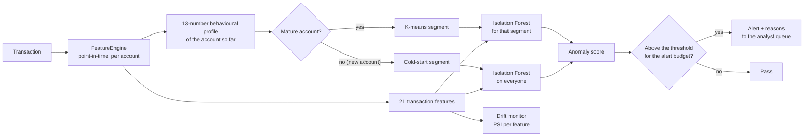

# Design

## The problem with "unusual"

Unsupervised fraud detection rests on one assumption: fraud is rare and different, so
whatever looks unusual is worth a look. The trouble is *unusual compared with whom*.

A bank's customers are not one population. A small business sends a few thousand euros to
suppliers every day. A retiree withdraws cash once a week and pays for groceries in the
morning. A gig worker gets a dozen small payouts at odd hours. Score all of them with one
model of normal, and the model mostly learns that *big* and *frequent* are unusual. Its
alert queue fills up with small businesses doing ordinary business, while a student's
account being drained in modest transfers at 3 a.m. looks unremarkable next to them.

Quant Hawk's answer, from the 2024 hackathon version and kept here, is to **segment first,
then learn normal per segment**: K-means groups customers by how they behave, and each
group gets its own Isolation Forest.

## Pipeline

## Features

`quanthawk.features.FeatureEngine` keeps a small state per account and updates it one
transaction at a time. The same code builds the training set (by replaying history in
time order) and scores live traffic, so a feature can never use information from the
future in training that it would not have in production. A test
(`test_features_are_point_in_time`) checks exactly that: the features of the first half of
a history do not change when the second half is appended.

Every feature is relative to the account's own past:

| Feature | Meaning |
|---|---|
| `log_amount` | size of the transaction |
| `amount_z` | standard score against this account's exponentially weighted history *on this channel* |
| `amount_vs_max` | log ratio to the largest amount this account has used on this channel |
| `n_1h`, `n_24h` | velocity: transactions in the last hour and day, this one included |
| `out_24h_vs_max` | money out over the last day, against the largest single payment the account had made before then (log ratio) |
| `new_in_24h_vs_max` | money in over the last day *from payers never seen before*, against the largest payment the account had received before then. A salary from the usual employer does not count; a stranger's deposit does |
| `passthrough` | for outgoing money: the share of the last day's money from new payers already sent on, a mule pattern |
| `log_gap` | time since the account's previous transaction |
| `new_device`, `new_counterparty`, `new_city`, `new_mcc` | first time this account has used this device, payee or merchant, city, merchant category |
| `new_cp_24h` | how many new payees or merchants in the last day |
| `hour_rarity` | −log P(this hour) under the account's own hour-of-day histogram |
| `log_account_age` | days since the account opened |
| `is_<channel>` | card in person, online, ATM, transfer out, transfer in |

## Segmentation

Each account's **profile** is a 13-number summary of its behaviour so far: pace
(transactions per day), channel mix, typical outgoing and incoming amounts (log), share of
activity at night and at weekends, and how many cities and devices it uses. An account
needs 25 transactions over at least 7 days before it has a profile.

K-means runs on the standardised profiles of mature accounts at the end of the training
window. The number of segments is chosen by the silhouette score over k = 3 to 10, on the
data, not by hand. On the simulated bank it usually picks 5, and the segments line up
with the hidden customer archetypes (adjusted Rand index around 0.7; see the benchmark).

A transaction is scored by the forest of the segment its account belongs to *at that
moment*. Accounts too new for a profile go to a **cold-start** forest trained on
everyone. They move to a segment once they have history. New accounts are where mule
fraud concentrates, so the cold-start path matters.

Segments with fewer than 2,000 training transactions do not get their own forest; they
fall back to the cold-start forest.

## Isolation Forest

Each forest has 200 trees, each built on 256 transactions sampled from its segment. A
transaction's score is how quickly random axis-aligned splits isolate it, normalised by
the expected path length for that sample size, so scores from different forests sit on
the same scale and one threshold works across segments.

Training data is not cleaned of fraud. In production nobody hands an unsupervised model a
clean history, so the benchmark does not either.

## Alert budget

A fraud team can work a fixed number of alerts a day. `qh train` records the score
thresholds that would have alerted 0.5 %, 1 % and 2 % of training traffic; the service
alerts above the threshold for its configured budget (1 % by default) and reports the
live alert rate, overall and per segment, so drift in volume shows up immediately.

## Explanations

An alert is only useful if an analyst can triage it in seconds. For each alert,
`SegmentedForest.explain` finds the features on which the transaction sits furthest
outside its own segment, measured against the segment's median and spread, and turns the
top three into sentences. Two real alerts from the demo bank (`qh demo`, seed 7), both
true fraud:

> **Student account, transfer out 2,225.71** (a mule passing money on)
> - payee or merchant never used on this account
> - 3 transactions in the last hour (typical for this segment: 1)
> - 6 new payees or merchants in the last 24 hours (typical for this segment: 1)

> **Salaried account, transfer out 714.82** (account takeover)
> - city never seen on this account
> - 4 transactions in the last hour (typical for this segment: 1)
> - payee or merchant never used on this account

The passthrough reason ("90 % of the last day's money from new payers already sent on")
is only shown when the money from new payers is a meaningful share of what the account
normally receives; passing on most of a small refund is not a mule pattern.

## Feedback and drift

Analysts mark each alert *fraud* or *legit*. The service stores the verdict next to the
alert and reports live precision of reviewed alerts. These labels are what a supervised
model would later be trained on (see the benchmark's supervised reference for what that
buys).

The drift monitor keeps the last 20,000 scored transactions and computes the population
stability index of every feature against the training distribution. Above 0.25 on any
feature, the model is scoring customers it has not seen, and it is time to retrain.

## What it does not do

- **It cannot see slow fraud well.** Small, plausible transactions spread over days
  (`low_and_slow` in the simulator) are almost invisible to any anomaly detector, because
  each one is unremarkable. That kind of fraud needs labels.
- **New accounts take more than their share of alerts.** In the demo bank, accounts too
  new for a profile are alerted on about 11 % of their transactions, against under 1.2 %
  for every segment. That is partly deliberate (new accounts are where mules appear) and
  partly the cold-start forest knowing too little; a team with limited capacity may want a
  separate, smaller budget for them.
- **It does not link accounts.** Mule networks move money across many accounts; seeing
  that needs a graph of who pays whom, which is out of scope here.
- **Synthetic data is not a bank.** The simulator (`quanthawk.simulate`) is built to be
  hard in realistic ways, and every assumption is in one file. Results on a real bank will
  differ.
